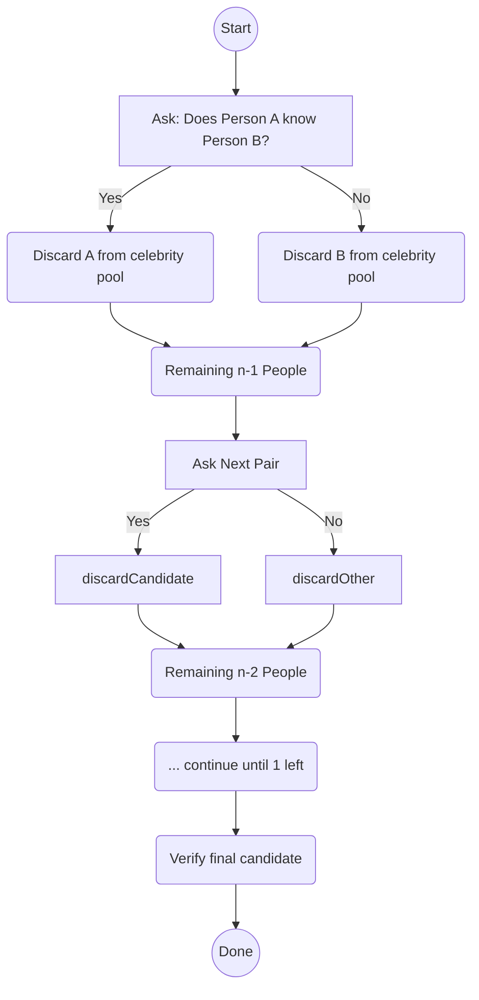

# Using Induction to Design Algorithms: A Deep Dive

> **Reference**: The article discussed is "Using Induction to Design Algorithms" by Udi Manber. All inline citations refer back to that paper, using the markers provided (e.g. :contentReference[oaicite:0]{index=0}).

Designing and teaching algorithms can be guided elegantly by **mathematical induction**, traditionally used just for proving correctness. In his paper, Udi Manber explores how the entire **idea** of induction can serve as a potent lens for *creating* algorithms, not merely verifying them. Below, we break down the primary **proof techniques** and **algorithmic patterns** he showcases, with notes on how they translate from mathematics to hands-on code.

1. [Overview](#overview)
2. [Techniques by Proof Style](#techniques-by-proof-style)
   1. [Basic Induction](#basic-induction)
   2. [Strengthening the Hypothesis](#strengthening-the-hypothesis)
   3. [Strong Induction (Dynamic Programming)](#strong-induction-dynamic-programming)
   4. [Maximal Counterexample](#maximal-counterexample)
3. [Algorithmic Patterns](#algorithmic-patterns)
   1. [Sorting-Oriented](#sorting-oriented)
   2. [Searching & Elimination](#searching--elimination)
   3. [Dynamic Programming](#dynamic-programming)
   4. [Graph Approaches](#graph-approaches)
   5. [Geometry](#geometry)
4. [Mermaid Diagrams & Examples](#mermaid-diagrams--examples)
5. [Example Table of Techniques vs. Problems](#example-table-of-techniques-vs-problems)
6. [Conclusion](#conclusion)

## Overview
Manber’s key premise is to **treat the design process itself** as an inductive proof. In combinatorial algorithm design, you rarely solve a large instance in one go. Instead, you pick a “simpler” subproblem (fewer elements, less structure, or partially solved states), solve that subproblem (often recursively), then grow your solution back to the full problem. 

This approach yields both a blueprint for correctness *and* a blueprint for the final code. While this viewpoint may seem natural in recursion, Manber’s broader theme is that *many* algorithmic techniques — from divide and conquer to dynamic programming — can be interpreted as “variations of induction” :contentReference[oaicite:1]{index=1}.

## Techniques by Proof Style

### Basic Induction
**Idea**: Show a base case; then reduce the main problem of size \(n\) to a solution for \(n-1\). 

- **Polynomial Evaluation**  
  Manber illustrates Horner’s Rule by noticing that removing either the first or last coefficient allows an inductive step. Evaluating a smaller polynomial plus a “small fix” leads to the entire solution. Specifically, the decision to factor out \(x\) (or not) influences the overall computation cost :contentReference[oaicite:2]{index=2}.

- **Intervals Containment**  
  Given a list of intervals, label any interval contained within another. Sorting the intervals by left endpoints (and further by right endpoints for ties) allows a near-constant-time inductive extension. Removing the “rightmost left endpoint” (or working from smallest to largest) is effectively the inductive step. Complexity drops to \(O(n \log n)\), dominated by sorting :contentReference[oaicite:3]{index=3}.

- **Finding One-to-One Mappings**  
  When a function \(f\) from a finite set to itself is not injective, we remove an element guaranteed *not* to belong to the largest one-to-one subset. Specifically, look for any element that has no preimage (i.e., no incoming edge in a functional digraph); it can safely be removed. This solves the problem for the reduced set by induction :contentReference[oaicite:4]{index=4}.

### Strengthening the Hypothesis
**Idea**: Make the inductive assumption stronger so that you carry extra information that simplifies the extension step.

- **Binary Tree Balance Factors**  
  Merely knowing all children’s balance factors is insufficient for a parent’s balance factor. You also need the **heights**. So, store both heights and balance factors at each node (the “stronger” problem). This makes it trivial to compute the parent’s balance factor once the children’s data are known :contentReference[oaicite:5]{index=5}.

- **Closest Pair of Points**  
  A naive divide-and-conquer can lead to \(O(n \log^2 n)\) time if you re-sort subproblems repeatedly. Instead, at every division step, *also* return the points sorted by \(y\)-coordinate as part of the inductive “solution.” Then merging sorted lists takes only \(O(n)\). This trick cuts total time to \(O(n \log n)\) :contentReference[oaicite:6]{index=6}.

### Strong Induction (Dynamic Programming)
**Idea**: Keep solutions for *all* subproblems up to size \(n\) (or up to capacity \(K\), etc.). Then any new subproblem can be solved by combining or looking up smaller results.

- **Knapsack Problem**  
  A naive method checks whether \(P(n, K)\) can be reduced to \(P(n-1, K)\) or \(P(n-1, K - k_n)\), but that might spawn exponential recursion. Strong induction plus a 2D table storing results for *all* \((i, j)\) with \(i \le n\) and \(j \le K\) yields an \(O(nK)\) approach. This is exactly dynamic programming: each solution is built from previously filled entries :contentReference[oaicite:7]{index=7}.

### Maximal Counterexample
**Idea**: Assume the statement is false and consider the “largest” failing example. Then show it leads to an even larger one, a contradiction.

- **Perfect Matching in Dense Graphs**  
  In a graph of \(2n\) vertices, each with degree \(\ge n\), a perfect matching must exist. If we assume no perfect matching, we start with a *maximal* (not maximum) matching and systematically enlarge it by a clever swap of edges. This contradiction-based argument can be turned into an algorithm: build a maximal matching quickly, then keep augmenting it until it becomes perfect :contentReference[oaicite:8]{index=8}.

## Algorithmic Patterns

### Sorting-Oriented
- **Interval Containment** uses sorting by endpoints to reduce checks to constant time per interval :contentReference[oaicite:9]{index=9}.  
- **Topological Sorting** (also described by Manber) conceptually “removes” an in-degree zero vertex in each inductive step. Though not a numeric sort, it’s a linearization of tasks in a partial order :contentReference[oaicite:10]{index=10}.

### Searching & Elimination
- **Celebrity Problem**: If Alice knows Bob, discard Alice as a celebrity candidate; otherwise discard Bob. This single question per iteration reduces \(n\) to \(n-1\). After linear time, only one person might be a celebrity. Verify in \(O(n)\) (or even less if you track known answers). Total time is \(O(n)\) :contentReference[oaicite:11]{index=11}.

### Dynamic Programming
- **Knapsack**: The classical example of storing partial solutions in a table. This exemplifies a robust strong-induction viewpoint. The method extends to many optimization problems in combinatorics and scheduling, etc. :contentReference[oaicite:12]{index=12}.

### Graph Approaches
- **Perfect Matching**: Achieved via repeated augmentation.  
- **Topological Sorting**: Again, remove an easy “base” vertex (indegree zero) and solve the smaller graph.

### Geometry
- **Closest Pair**: A shining example of divide-and-conquer augmented by sorting. The geometry-specific logic about bounding boxes (“strips”) and limited neighbors per row is a hallmark of the technique :contentReference[oaicite:13]{index=13}.

---

## Mermaid Diagrams & Examples

### Example: **Celebrity Elimination**

